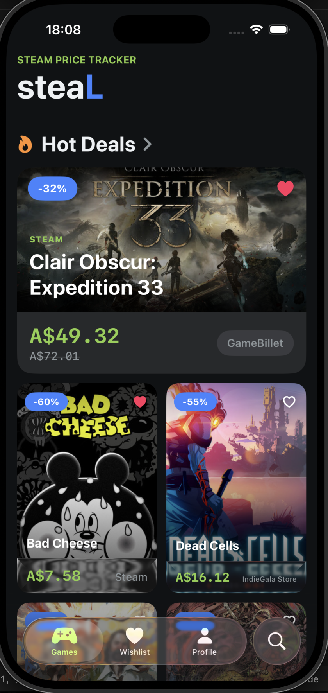
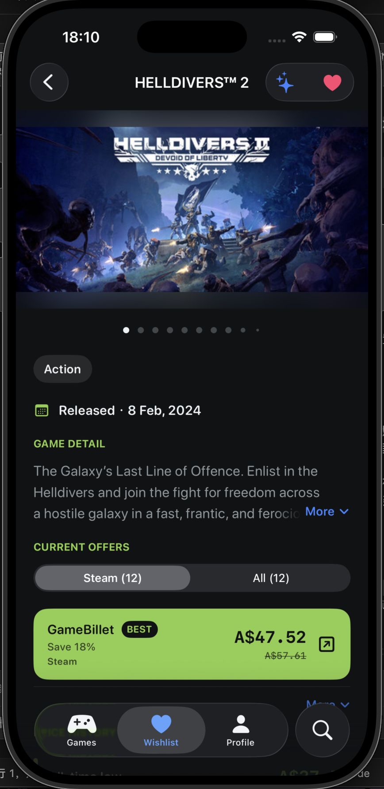
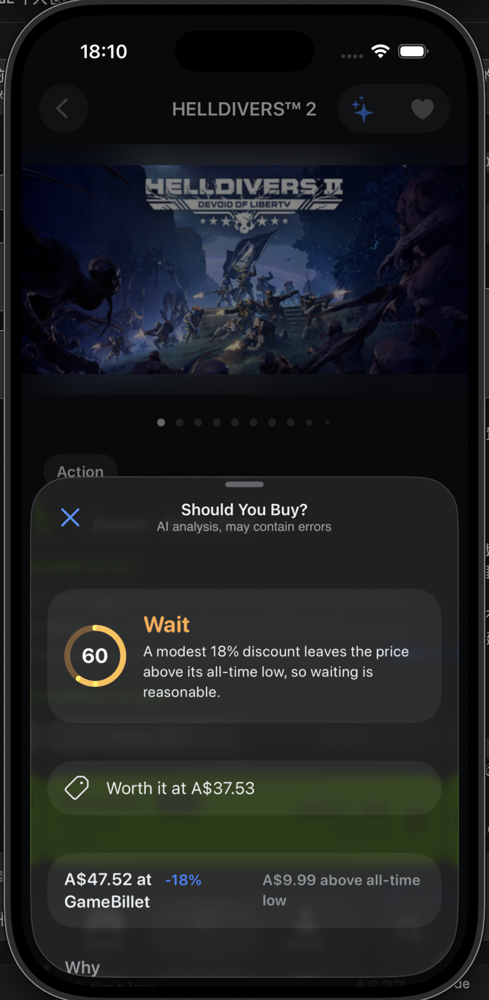
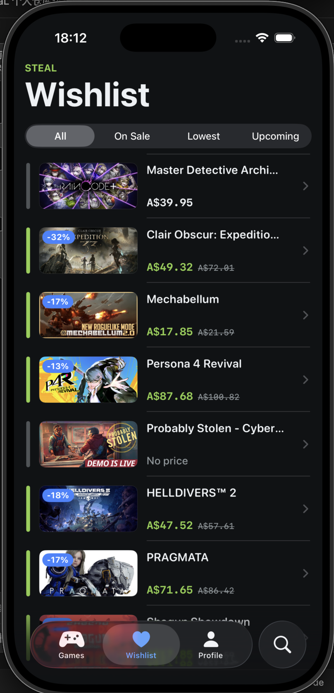

<p align="center">
  
</p>

<h1 align="center">steaL</h1>

<p align="center">
  <b>English</b> | <a href="README.zh-CN.md">简体中文</a>
</p>

<p align="center">
  A native iOS app for finding Steam deals, comparing prices across stores, and deciding whether to buy now or wait.
</p>

<p align="center">
  
  
  
  
</p>

<p align="center">
  
  
  
  
</p>

## About

steaL is a solo project built for Monash University's **FIT3178 iOS App Development** unit. It combines
[IsThereAnyDeal](https://isthereanydeal.com) price data with the Steam Store API, so you can see a game's
current price in every store, its historical low, and an AI recommendation on whether the deal is worth it.

The app is built entirely with SwiftUI and Apple frameworks. Firebase (Auth and Firestore) is the only
third-party package.

## Features

- **Deals and giveaways.** The Games tab shows today's best Steam deals and free giveaways. Hot Deals
  is a paged, genre-filterable grid.
- **Price comparison.** Every game page shows the price in each store that sells it, the historical low,
  and Steam details: trailers and screenshots, reviews, genres, and links between demos and full games.
- **AI purchase advice.** Tap ✨ on a game page to get a **Buy / Wait / Skip** verdict, with reasons
  based on the current price, the historical low and the release status.
  - Uses any OpenAI-compatible Chat Completions provider.
  - Bring your own provider and model: API keys are stored in the **Keychain**, never in the database.
- **Wishlist with alerts.** Save games with the heart button. Your wishlist syncs through Firestore and
  can be filtered by *On Sale*, *Lowest* and *Upcoming*. Local notifications tell you about price drops
  and releases.
- **Search** across the Steam store, using the iOS 26 search tab.
- **Optional account.** Email sign-in, password reset, and in-app account deletion. Browsing never
  requires an account.
- **Personalisation.** Seven store regions and currencies, Steam content in English or Simplified Chinese,
  and light / dark / system themes.
- **Accessibility.** Dynamic Type layouts that adapt at accessibility sizes, VoiceOver labels and traits,
  plus onboarding and TipKit hints.

## Tech Stack

| Area | Technology |
| --- | --- |
| UI | SwiftUI (iOS 26, Liquid Glass), TipKit, AVKit |
| State | Observation (`@Observable`), Swift Concurrency (`async`/`await`, `async let`, task cancellation) |
| Local storage | SwiftData (settings and LLM providers), Keychain (API keys) |
| Cloud | Firebase Auth, Cloud Firestore (real-time wishlist with `snapshots` async sequence) |
| Networking | `URLSession` + `Codable`, no networking library |
| APIs | [IsThereAnyDeal API](https://docs.isthereanydeal.com), Steam Store API, OpenAI-compatible Chat Completions |
| Tooling | SwiftLint, `os.Logger`, privacy manifest (`PrivacyInfo.xcprivacy`) |

## Architecture

MVVM with one `NavigationStack` per tab:

```
Views       SwiftUI screens and components; read settings with @Query, own their ViewModel with @State
ViewModels  @MainActor @Observable state machines (one enum state per async section)
Services    Stateless API clients (SteamAPI, ITADAPI, LLMAPI) and observable services (Auth, Wishlist)
Models      Codable DTOs for ITAD / Steam / Chat Completions, SwiftData models, app view models
```

Some design decisions:

- **Independent loading sections.** Each section of a page loads independently, with its own state
  (`loading / loaded / notFound / failed`). A slow or failed price request doesn't block the rest of
  the game page.
- **"Not found" is not an error.** Services return `nil` when there is no data and throw only when a
  request fails. A shared `LoadError` maps network errors to four user-facing failures.
- **Steam app ID lookup.** ITAD identifies games by its own UUIDs, which have to be mapped to Steam app
  IDs. When ITAD returns several candidate Steam app IDs, the app checks them against Steam and picks
  the one that is still for sale.
- **Single source of truth.** The wishlist lives only in Firestore. ViewModels query and check
  the data but don't keep a second copy.
- **Custom trailer player.** Trailers use an `AVPlayerLayer` player inside the paged gallery, so the
  seek bar doesn't conflict with swiping between pages. Full screen uses the system
  `AVPlayerViewController`.

## Getting Started

**Requirements:** Xcode 26 with the iOS 26.5 SDK.

1. Clone the repository and open `steaL.xcodeproj`.
2. Copy the secrets template and fill in your keys:
   ```sh
   cp Secrets.example.xcconfig Secrets.xcconfig
   ```
   | Key | Required | Where to get it |
   | --- | --- | --- |
   | `ITAD_API_KEY` | Yes, for deals and prices | [isthereanydeal.com/apps](https://isthereanydeal.com/apps/my/) |
   | `LLM_API_KEY`, `LLM_API_URL`, `LLM_MODEL` | Only for the built-in AI model | Any OpenAI-compatible provider (defaults to DeepSeek) |

   In an `.xcconfig` file, `//` starts a comment, so write URLs as `https:/$()/example.com`.
   You can also skip the built-in model and add your own provider in **Profile → AI** inside the app.
3. **Firebase (optional).** `steaL/GoogleService-Info.plist` points to the author's Firebase project.
   To use your own, create a Firebase project with Email/Password Auth and Firestore, then replace the
   file. The wishlist is stored at `users/{uid}/wishlist/{appID}`.
4. Build and run on an iOS 26.5 simulator or device.

The app builds without `Secrets.xcconfig`, but deals and prices will fail to load until an ITAD key is
set.

## Project Structure

```
steaL/
├── Config/          Info.plist-backed configuration, Logger categories
├── Models/          ITAD/, Steam/, AI/, App/, Settings/, Previews/
├── Services/        API clients, Auth, Wishlist, Keychain, notifications
├── ViewModels/      One per screen
└── Views/           Screens, plus Components/ grouped by the screen that uses them
email-templates/     HTML body for the Firebase password-reset email
icon/                Icon Composer sources for the Liquid Glass app icon
```

## Known Limitations

- Price-drop and release alerts are checked when the app returns to the foreground. There is no
  background refresh yet.
- The built-in LLM key is read from `Info.plist`, which is not secure for a shipped app. A
  production version would need a server-side proxy.
- Not published on the App Store.

## Data Sources & Attribution

- Price and deal data from [IsThereAnyDeal](https://isthereanydeal.com).
- Game details, media and search from the Steam Store.
- AI advice is generated by a language model. It may be wrong and is not financial advice.

steaL is not affiliated with IsThereAnyDeal or Valve. Steam and the Steam logo are trademarks of Valve
Corporation.

## Author

**Yijiang Luo**, Monash University. [GitHub](https://github.com/JohnWes7)
